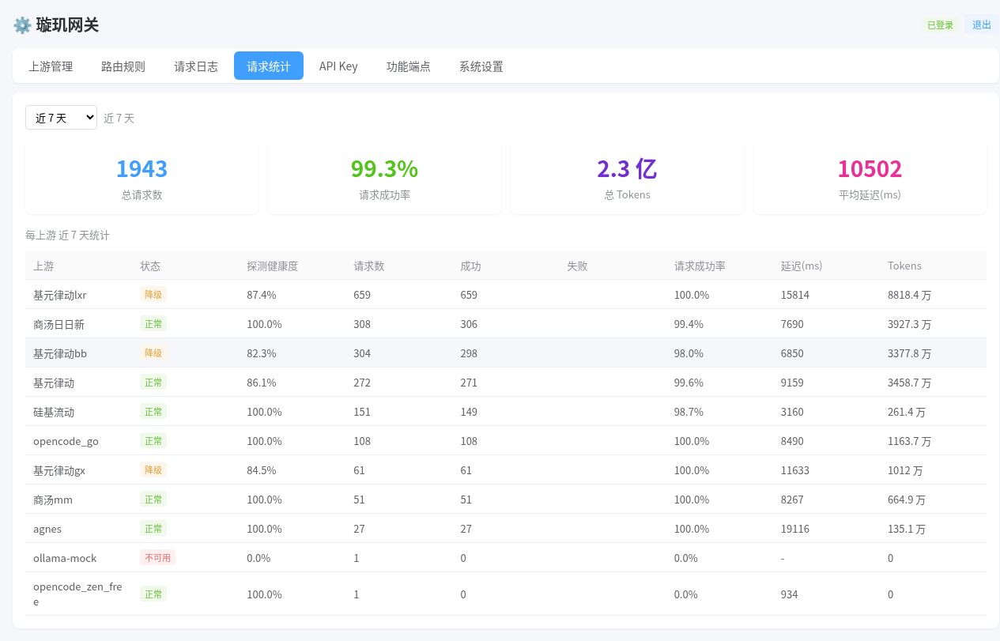
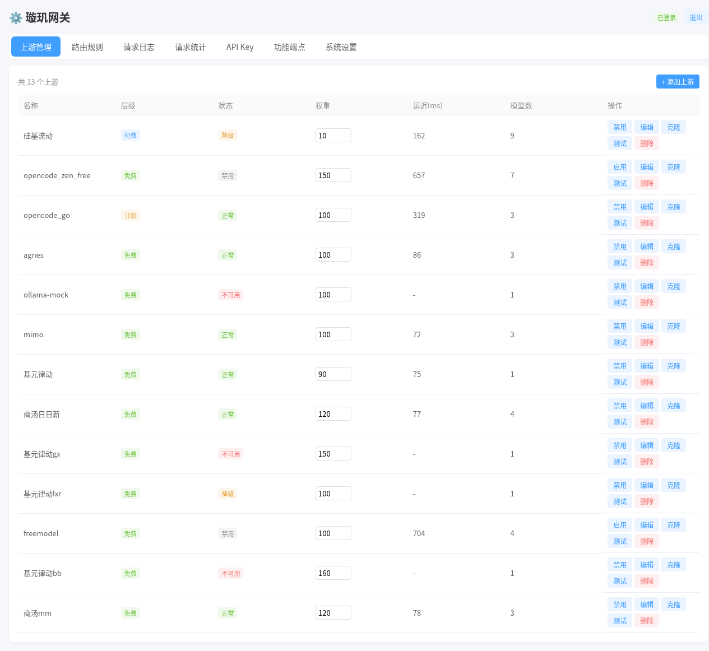
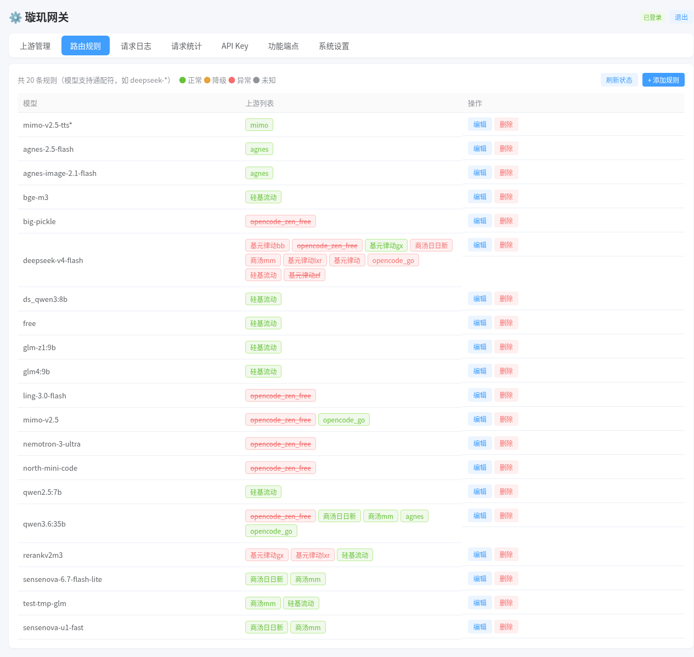
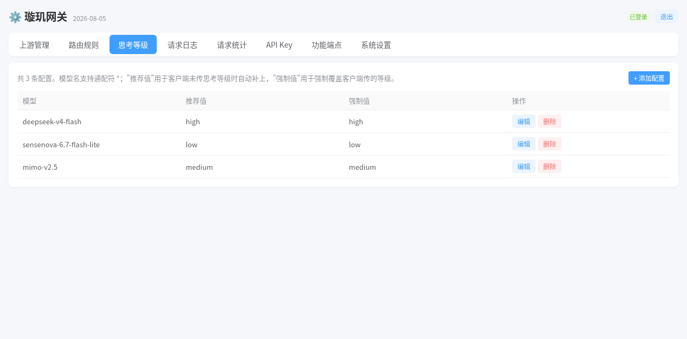
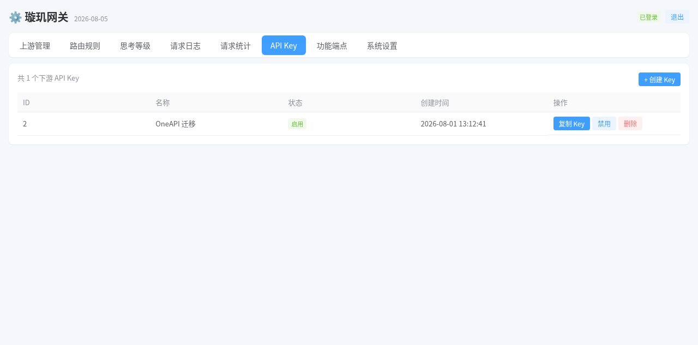
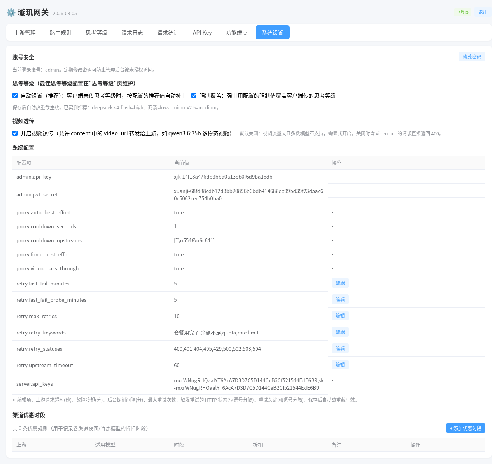

# 璇玑 Xuanji

<p align="center">
  <a href="https://github.com/icefairy/xuanji">
    
  </a>
  <a href="https://github.com/icefairy/xuanji">
    
  </a>
  <br>
  <sub>如果这个项目对你有帮助，不妨在 GitHub 上点亮 Star ⭐，让更多开发者发现它</sub>
</p>

> **OpenAI / Anthropic 协议汇聚 · 负载 · 分流网关**  
> *Go 生态 · 单二进制 · 零外部依赖 · one-api / LiteLLM 轻量替代*

璇玑（北斗第一星，古代天文仪器的轴心枢纽）——汇聚万向，运转分流。  
用 Go 自研的轻量 AI 网关，为 Hermes、Claude Code、OpenCode 等各类 AI 工具提供一个统一入口，汇聚多家上游（硅基流动、商汤、DeepSeek 系中转、vLLM、OpenRouter 等），按成本与健康状态自动分流。

**它是 one-api / new-api / LiteLLM / Portkey / Kong AI Gateway 等网关的轻量替代品**：同样解决"多家上游统一入口、API Key 管理、成本控制、故障切换"，但体积、依赖、部署成本低一个量级；同时它也是 **CC Switch 这类桌面配置切换器的服务端替代方案**——不需要切换，网关自动调度。

> **🎯 定位：个人 / 小团队自用**。没有计费、用户管理、配额兑换码等运营功能，短期内也不打算加入——它是给你自己的 AI 工作流做统一入口与成本调度的，不是给多用户做计费分发的。按 API Key 的用量统计（请求数 / Tokens / 成功率）可以帮你区分不同 AI 程序用得多。

> **GitHub**：[https://github.com/icefairy/xuanji](https://github.com/icefairy/xuanji) — 欢迎 Issue、PR、Star ⭐

---

### 💬 加入微信社群

<p align="center">
  
  <br>
  <sub>扫码加入璇玑交流群，一起探讨 AI 网关的使用与优化</sub>
</p>

---

## 为什么自研

现有 `oneapi` / `new-api` 等网关对 OpenAI 协议兼容不好（流式、工具调用、多模态字段容易丢），且太重。本项目追求：

- **轻量**：Go 单二进制 + SQLite，零外部依赖，内存占用极小
- **协议严格**：OpenAI + Anthropic 双协议，流式 SSE 逐行透传
- **可控**：所有配置数据库化，CRUD 即热重载，全程可视化

## 核心特性

> **v1.2.0 新功能**：⏱️ [时间线注入](#️-时间线注入让模型知道过了多久)——让模型知道「你隔了多久才回来」，只改最后一条消息，上游前缀缓存零影响。默认关闭，系统设置一键开启。

### 🧭 双协议接入

| 协议 | 端点 | 说明 |
|------|------|------|
| **OpenAI** | `POST /v1/chat/completions` | 聊天补全（流式/非流式） |
| | `POST /v1/embeddings` | 文本嵌入 |
| | `POST /v1/images/generations` | 图片生成 |
| | `POST /v1/rerank` | 重排 |
| | `POST /v1/audio/speech` | 语音合成 |
| | `POST /v1/audio/transcriptions` | 语音识别 |
| | `GET /v1/models` | 模型列表 |
| **Anthropic** | `POST /v1/messages` | Claude 消息（Claude Code 直接接入，流式事件转换） |
| **SystemOne** | `POST /v1/systemone` · `POST /v1/decisions` | 决策模型（choice / noul / score 概率打分） |

鉴权双风格：`Authorization: Bearer <key>` 与 `x-api-key: <key>` 均可，兼容各类 SDK。

### 🎲 SystemOne 决策协议

除了「生成文本」的模型，网关也接**决策模型**（如 InternLM 的 `intern-decision-4b`）。
这类模型不生成文字、不流式，而是对一段 state 一次性回答多个带类型的问题，每题给出概率分布：

| 问题类型 | 请求 `criteria` | 返回 |
|------|------|------|
| `choice` | 选项 → 描述的映射 | `choice`（最可能选项）+ `probabilities` + `confidence` |
| `noul` | 可选 `{"true":…,"false":…}` | `noul`（为真的概率，0~1） |
| `score` | 有序档位数组（低 → 高，2~10 档） | `score`（0 基期望分）+ `probabilities` + `legend` |

```bash
curl -sS http://127.0.0.1:3001/v1/systemone \
  -H "Authorization: Bearer $XUANJI_KEY" -H "Content-Type: application/json" \
  -d '{
    "model": "intern-decision-4b",
    "state": "客户重复扣款，要求今天退款",
    "questions": {
      "team":   {"type": "choice", "instructions": "哪个团队处理?",
                 "criteria": {"billing": "账单退款", "tech": "技术故障"}},
      "urgent": {"type": "noul", "instructions": "客户要求今天回复?"},
      "anger":  {"type": "score", "instructions": "客户情绪程度",
                 "criteria": ["平静", "不满", "非常愤怒"]}
    }
  }'
```

接入要点：

- **两套决策格式都支持**：`/v1/decisions` 收 OpenAI Decisions 格式（`input` 消息数组 + `questions` **数组**，类型 `predicate`/`choice`/`score`），网关自动转成 SystemOne 发给上游、再把响应转回来；`/v1/systemone` 保持纯透传。
  - ⚠️ **判定依据是 `questions` 的 JSON 类型而不是请求路径**：数组 → 按 OpenAI Decisions 处理并转换；对象 map → 按 SystemOne 原样转发。因此 `/v1/decisions` 收到 SystemOne 格式、`/v1/systemone` 收到 Decisions 格式都能正常工作，但混用时请确认格式自洽，否则上游会返回 400。
  - 两类格式的题目类型不能混搭：Decisions 用 `predicate`/`choice`/`score`，SystemOne 用 `noul`/`choice`/`score`（`predicate` 与 `noul` 是同一语义的不同名字）。
- **路径别名**：`/systemone`、`/v1/jev`、`/v1/predict` 同样命中，方便 base_url 已含 `/v1` 或沿用旧 SDK 的客户端，鉴权与配额一视同仁。
- **路由完全复用**：和 chat 一样按 `tier → weight → 优惠时段 → 延迟` 选上游，5xx/超时自动换下一个，4xx 直接透传（不算上游故障）。
- **配额与计费一致**：走同一套 API Key 鉴权与分组配额；`usage.input_tokens/output_tokens` 计入 `request_log`（endpoint 记为 `decisions`）与费用统计。
- **`noul` 可省 `criteria`**：网关会自动补 `true`/`false` 默认描述，兼容强制校验该字段的上游（书生）。
- **上游路径固定 `/v1/systemone`**：实测书生 `intern-decision-4b` 的 `/v1/decisions`、`/v1/jev` 均返回 404，只提供 `/v1/systemone`，因此**无需给上游新增协议类型**，转发路径不变。
- 决策模型不支持流式、聊天补全与嵌入，别把它配到 `/v1/chat/completions` 的路由规则上。

OpenAI Decisions 格式示例（同一模型、同一上游）：

```bash
curl -sS http://127.0.0.1:3001/v1/decisions \
  -H "Authorization: Bearer $XUANJI_KEY" -H "Content-Type: application/json" \
  -d '{
    "model": "intern-decision-4b",
    "input": [{"role": "user", "content": "客户重复扣款，要求今天退款"}],
    "questions": [
      {"type": "predicate", "name": "refund", "instructions": "客户是否要求退款?"},
      {"type": "choice", "name": "team", "instructions": "哪个团队处理?",
       "choices": [{"value": "billing", "description": "账单"}, {"value": "tech", "description": "技术"}]},
      {"type": "score", "name": "anger", "instructions": "情绪程度",
       "levels": [{"label": "calm", "description": "平静"}, {"label": "angry", "description": "愤怒"}]}
    ]
  }'
```

字段映射：`predicate → noul`（答案 `noul` → `probability`）、`choices[] → criteria{}`、`levels[] → criteria[]`；响应按请求顺序返回，缺答案的题目不伪造概率。

### 💰 成本优先的路由

统一优先级策略（无需选择，规则内置）：

1. **计费层级**：免费 > 包月 > 按量付费
2. **同层权重**：weight 高的上游优先
3. **同层同权重**：处于优惠时段（如夜间折扣）的上游优先
4. **同层同权重同折扣**：网络延迟低的上游优先（健康检查实时探测，未测过延迟的排最后）
5. **失败切换**：同层内逐个尝试，全挂自动升级到下一计费层级

### 🛡️ 高可用

- **自动分流**：每个模型绑定多个上游，网关按计费层级、权重、健康度自动选择最优通道
- **自动负载**：同层权重调度，高权上游多发、低权少发，避免单点过载
- **自动重试**：上游失败自动切到同层下一个，整层失败自动升到下一计费层级，**不会因为任何一个上游故障导致请求中断**
- **健康检查**：每上游独立探测，healthy / degraded / dead 三态；探测端点按上游能力
  `kind`（chat / emb / rerank / tts / asr / image，默认 chat）选择对应端点，且统一用占位模型名 +
  无凭证请求——不会触发真实推理（零算力消耗）；2xx 与全部 4xx 视为“服务在线”，仅 5xx/超时/断连判死，
  避免纯 TTS/embedding 等上游被 chat 探测误判 dead
- **快速失败熔断**：失败上游自动进冷却名单，后台定时探测自动恢复
- **客户端断连保护**：断连不误拉黑上游（← 实测 6 个上游被误拉黑的坑已修复）
- **主备架构**：可配合 Nginx 做 100% 主备兜底

### 🎛️ 全数据库化配置 + 管理界面

- 上游、路由规则、折扣、API Key、**最佳思考等级** 全部存 SQLite，页面 CRUD **即改即热重载**
- Vue 管理页面（无构建工具，纯 CDN，**嵌入二进制**，单文件即可跑）：上游管理 / 路由规则 / **思考等级** / 请求日志 / 请求统计 / API Key / 功能端点 / 系统设置
- **管理 API**：独立鉴权 key（`/api/admin/*`），AI 助手可免登录动态改配置
- 多实例共享同一数据库，可多端口部署

<p align="center">
  
  <br>
  <sub>📊 统计总览 — 总览卡片（请求数/成功率/Tokens/延迟）+ 每日 Token 趋势折线图 + 每上游请求数/成功率/延迟/Tokens 明细 + 每 API Key 用量统计，点击展开行可看该 Key 使用的模型分布饼图</sub>
</p>

<p align="center">
  
  <br>
  <sub>⚙️ 上游管理 — 添加/编辑/克隆/删除上游渠道，配置计费层级（免费/包月/按量）、权重、模型映射，健康检查三态（正常/降级/不可用）</sub>
</p>

<p align="center">
  
  <br>
  <sub>🔄 路由规则 — 模型名支持通配符（如 `deepseek-*`），每规则绑定一组上游，网关自动分流、负载、重试</sub>
</p>

<p align="center">
  
  <br>
  <sub>🧠 思考等级 — 管理每个模型的最佳 `reasoning_effort` 推荐值，支持模型通配符，配合系统设置"自动推荐"和"强制覆盖"开关</sub>
</p>

<p align="center">
  
  <br>
  <sub>🔑 API Key 管理 — 创建/禁用/删除下游 key，复制 key 供客户端使用</sub>
</p>

<p align="center">
  
  <br>
  <sub>⚙️ 系统设置 — 账号安全、思考等级自动推荐/强制覆盖开关、视频透传开关、重试策略（熔断时长/探测间隔/超时/重试状态码/关键词）、渠道优惠时段配置</sub>
</p>

### 📊 可观测性

- 请求日志：东八区时间、筛选、分页
- 请求统计：今日 / 3天 / 7天 / 30天 / 全部 五个维度，每上游请求数、延迟、成功率、Token 总量；每 API Key 用量统计（点击展开行查看该 Key 的模型分布饼图，区分不同 AI 程序用的模型）；**每上游行可展开看「上游 × 真实模型」明细（tokens/秒、平均输出、TTFT），用于分辨同一上游下各模型的快慢**
- 上游健康告警：配置 Webhook 后，上游连续探测失败达阈值（降级/不可用）或恢复时自动推送（同一上游同类告警 10 分钟冷却）
- **Token 计数**：流式响应注入 `stream_options.include_usage` 并逐 chunk 解析，非流式回退 tiktoken 估算

### 🧠 思考深度归一化（Thinking Effort 协议翻译）

不同模型控制"思考强度"的参数五花八门：OpenAI 用 `reasoning_effort`，DeepSeek 用 `reasoning_effort` + `thinking.type`，商汤用 `output_config.effort`，Kimi K2/GLM 只有 `thinking.type` 开关……客户端挨个适配太痛苦。

**璇玑在网关层做了归一化：下游永远用 OpenAI 标准协议，网关按目标模型自动翻译。**

客户端只需传标准参数（与 OpenAI o 系列一致）：

```json
{
  "model": "任意模型",
  "reasoning_effort": "none | low | medium | high"
}
```

网关按上游真实模型自动转换：

| 目标模型族 | none（关闭思考） | 强度控制 |
|---|---|---|
| **DeepSeek V4** (flash/pro) | `thinking.type=disabled` | `reasoning_effort: low/high/max`（原生透传，pro 的 low 档自动抬到 high） |
| **商汤** sensenova-* | `thinking.type=disabled` | 自动转 `output_config.effort: low/medium/high` |
| **Kimi K3** | 始终思考 → 映射为 `low` | `reasoning_effort: low/high/max`（原生透传） |
| **Kimi K2.x** | `thinking.type=disabled` | 只开关，无强度档 → `thinking.type=enabled` |
| **GLM-4.5** | `thinking.type=disabled` | 只开关，无强度档 → `thinking.type=enabled` |
| **Qwen3 / 3.5 / 3.6 / 3.7** | `enable_thinking=false` | 无 effort 档 → `enable_thinking=true` + `thinking_budget` 分档（low=1024 / medium=4096 / high=8192） |
| **OpenAI o3/o4/GPT-5** | `reasoning_effort=none` | 原生支持，完全透传 |

- 请求体没有 `reasoning_effort` 时**零开销**（原样透传，不改 body）
- 未知模型也原样透传，绝不破坏请求
- 单条请求即可控制，无需每模型单独适配——**一套代码接入所有思考模型**

> **Qwen 系列差异说明**：Qwen3/3.5/3.6/3.7 都是混合思考模型（`enable_thinking` + `thinking_budget`），但默认状态不同——Qwen3.5 开源小模型**默认禁用思考**（显式开启才有推理），Qwen3/3.6 默认思考（可关闭）；Qwen3 支持 `/think` `/no_think` 提示词软切换，Qwen3.6 不支持。**Qwen2.5 无思考模式**，不匹配本特性，原样透传。

### 🎯 最佳思考等级（自动推荐 + 强制覆盖）

> 2026-08-03 新增，基于 57 题实测数据。

不同模型在不同思考等级下的表现差异很大——有些模型 medium 才最优，有些 high 反而掉分。你不可能记住每个模型该用哪个等级，璇玑帮你记。

**三步搞定：**

1. **评测数据预置**：我们已实测 3 个主流免费模型，推荐值写进数据库：

| 模型 | 推荐等级 | 实测得分 |
|------|---------|---------|
| DeepSeek V4 Flash | `high` | 54/57 (94.7%) |
| 商汤 sensenova-6.7-flash-lite | `low` | 53/57 (93.0%) |
| mimo-v2.5（免费渠道） | `medium` | 53/57 (93.0%) |

2. **管理页「思考等级」Tab**：查看/编辑配置，支持模型通配符（如 `deepseek-*`），推荐值、强制值随意改

3. **系统设置两个开关**：

| 开关 | 行为 | 适用场景 |
|------|------|---------|
| **自动设置（推荐）** | 客户端没传 `reasoning_effort` 时，自动补上推荐值 | 客户端代码不改也能用上最优等级，零侵入 |
| **强制覆盖** | 不管客户端传了什么，一律用强制值覆盖 | 统一管理所有客户端的思考等级，省得逐个改 |

**示例**：开启自动推荐后，客户端请求即使不传 `reasoning_effort`，网关也会自动注入推荐值并归一化。

```json
// 客户端发（无 effort）
{"model": "deepseek-v4-flash", "messages": [...]}

// 网关自动注入推荐值
{"model": "deepseek-v4-flash", "messages": [...], "reasoning_effort": "high"}

// 经过归一化（DeepSeek 原生 reasoning_effort）→ 原样透传，不再转换
```

> 开启强制覆盖后，客户端传的 `"reasoning_effort": "low"` 会被强制换成 `high`——适合你发现某个等级最优后，让所有客户端都受益。

### 🔌 开箱即用的渠道适配

- **Ollama 上游**：配置 `type: ollama` 的上游后，通过 OpenAI `POST /v1/chat/completions` 入口自动转换协议转发（无需额外配置）
- **mimo TTS 桥接**：小米免费 TTS（`mimo-v2.5-tts` 系列），自动完成标准 OpenAI 协议 ↔ mimo 私有协议转换
- **思考型模型兼容**：max_tokens 不足时模型可能返回"只有思考无正文"的响应——只要思考字段（`reasoning`/`reasoning_content`）有值即视为正常透传，不误判为故障切换上游
- **模型映射**：客户端简单名 ↔ 上游真实名自动转换，`THUDM/GLM-4-9B-0414` → `glm4:9b`

### ⏱️ 时间线注入（让模型知道「过了多久」）

> **新功能（v1.2.0）**，默认关闭，在「系统设置 → 时间线注入」一键开启。

大模型没有时间感。你和它聊了三小时再回来接着问，它还以为刚刚才说过话；客户端把历史消息原样发过来，里面一个时间戳也没有。

璇玑可以在**最后一条 user 消息前**补上两行：

```
【时间】2026-09-10 14:05 周四（Asia/Shanghai）
【距上轮】3 小时 22 分钟
过了很久我又来了…
```

**为什么是「只改最后一条」**：前面所有历史消息一个字节都不动，上游的**前缀缓存完全不受影响**——这是本功能能做到「零成本」的关键。若给每条消息都打时间戳，缓存会当场全废。

**会话怎么识别**（无需客户端配合）：网关是无状态的，只能靠指纹认人：

- `chainKey` = hash(API Key + 全部消息内容)，对长对话做前缀采样（首 4 条 + 末 3 条），保证跨轮哈希稳定
- `tailKey` = hash(最后一条消息)，用来区分「新的一轮」与「同一轮重发」——重试不会把间隔清零
- 客户端每轮会把 assistant 回复追加进历史，前后两轮不是前缀关系，所以用**多候选回退**（截掉尾部 1~3 条逐一试查）把两者接上

**存储**：内存 LRU（默认上限 10 万会话、TTL 30 天）+ SQLite 异步落库，**进程重启后「距上轮」依然连续**。只存哈希与时间戳，不落任何消息明文。

**配置项**（全部在管理界面）：

| 键 | 默认 | 说明 |
|---|---|---|
| `proxy.time_context_enabled` | `false` | 总开关 |
| `proxy.time_context_tz` | `Asia/Shanghai` | 时区（IANA 名） |
| `proxy.time_context_format` | `%Y-%m-%d %H:%M` | strftime 格式 |
| `proxy.time_context_template` | `【时间】{{datetime}} {{weekday}}（{{tz}}）` | 注入模板 |
| `proxy.time_context_min_gap` | `5` | 间隔小于 N 分钟不显示 |
| `proxy.time_context_include_gap` | `true` | 是否显示「距上轮」 |
| `proxy.time_context_max_sessions` | `100000` | 会话表上限 |
| `proxy.time_context_ttl_days` | `30` | 会话保留天数 |
| `proxy.time_context_persist` | `true` | 重启后是否保留 |

**适用范围**：`/v1/chat/completions`、`/v1/messages`（Anthropic）、Gemini 三个入口共用同一张会话表，切协议时时间线连续。纯工具回填轮次（content 只有 `tool_result`/`tool_use`）自动跳过。

**已知边界**（说清楚比藏着好）：

- 用户在客户端里**编辑或删除历史消息** → 指纹变了，会被当成新会话，丢失一次间隔记忆（不会报错）；
- 两个不同会话恰好共享完全相同的历史前缀 → 可能被合并（实际极少见）；
- 间隔粒度取决于会话表 TTL，超过 30 天视为新会话；
- 这是**近似**方案。如果你用 Hermes Agent 这类支持插件的客户端，[hermes-time-context](https://github.com/icefairy/hermes-time-context) 能做到精确到秒且不受上述限制——两者可共存，也可只开一头。

## 快速开始

> **📖 新手请看图文教程**：[璇玑网关使用说明（小白版，含截图）](docs/使用说明.md)

```bash
# 构建
go build -o xuanji-server ./cmd/server

# 启动（默认 8787 端口，首次启动自动建库 + 写入默认配置）
./xuanji-server --port 8787 --db ./xuanji.db
```

首次启动后：
1. 访问 `http://<host>:8787/`，默认账号 `admin` / `xuanji123`（请尽快修改）
2. 「上游管理」添加你的上游渠道（名称 / Base URL / API Key / 计费层级 / 权重 / 模型映射）
3. 「路由规则」把模型映射到上游组
4. 客户端指向网关地址，用「API Key」Tab 创建的下游 key 访问

### 🐳 Docker 部署

镜像基于 `golang:1.26-alpine` 多阶段构建，**静态编译 + 精简 alpine 运行**，开箱即用（已内置东八区时区与 CA 证书）：

```bash
# 方式一：docker compose（推荐）
docker compose up -d --build

# 方式二：docker run 直接跑
docker build -t xuanji .
docker run -d --name xuanji \
  -p 8787:8787 \
  -v $(pwd)/data:/data \
  --restart unless-stopped \
  xuanji
```

数据持久化：数据库存 `/opt/xuanji.db`（卷映射到宿主机 `./data` 目录），升级容器不丢配置。

### Supervisor 部署（裸机）

```ini
# /etc/supervisor/conf.d/xuanji.conf
[program:xuanji]
command=/opt/xuanji/xuanji-server --port 3001 --db /opt/xuanji/xuanji.db
directory=/opt/xuanji
stopasgroup=true
autorestart=true
user=root
```

## 配置

全部配置存 SQLite（默认 `xuanji.db`），无需 YAML：

| 配置项 | 说明 |
|---|---|
| `upstreams` | 上游渠道：类型、Base URL、API Key、计费层级（free/subscription/payg）、权重、模型列表、模型映射 |
| `routing_rules` | 路由规则：模型（支持通配符）→ 上游组 |
| `discounts` | 渠道优惠时段：上游、适用模型、起止时间（支持跨天）、折扣率 |
| `api_tokens` | 下游 API Key：为客户端创建、启用/禁用 |
| `config` | 网关参数：端口、重试策略、熔断冷却等 |

## 路由优先级详解

```
┌─ 免费 (free) ──────────────────────┐
│  weight 高优先 → 折扣时段优先 → 延迟低优先 │ ─┐ 同层全失败
├─ 包月 (subscription) ──────────────┤  │ 自动升级
│  weight 高优先 → 折扣时段优先 → 延迟低优先 │ ◀┘
├─ 按量 (payg) ─────────────────────┤
│  weight 高优先 → 折扣时段优先 → 延迟低优先 │
└────────────────────────────────────┘
```

同一层级内失败自动尝试下一个；整层失败升到下一计费层级；全部失败返回 502。同层同权重同折扣时，取健康检查延迟最低的上游（延迟数据实时探测，未测过的排最后）。

## 技术栈

- **语言**：Go 1.26+（标准库 `net/http` 增强路由，无框架）
- **存储**：SQLite（`modernc.org/sqlite` 纯 Go 无 CGO），WAL 模式 + 内存页缓存
- **上游 SDK**：`openai-go`（协议严格）
- **前端**：Vue 2 CDN + 原生 HTML（无构建工具，离线可用）
- **鉴权**：bcrypt + 自实现 JWT（HMAC-SHA256，零依赖）

## 测试

```bash
go build ./... && go test ./...
# 499 个测试全绿，覆盖协议转换、路由选择、熔断、思考归一化与最佳等级注入、时间线会话指纹
```

## 与同类项目对比

### 对比 OneAPI / New-API（服务端网关）

| 特性 | 璇玑 Xuanji | OneAPI / New-API |
|------|------------|------------------|
| 语言/形态 | Go 单二进制 | Go 单二进制（含前端资源） |
| 体积 | ~18MB | 镜像 ~200MB（alpine） |
| 外部依赖 | 零（SQLite 内置） | 需 MySQL/Redis（New-API 默认 SQLite，可选 MySQL/PG） |
| 协议入口 | OpenAI + Anthropic 双原生 | 仅 OpenAI 统一入口（Claude 等上游走转换） |
| 流式兼容 | 逐行 SSE 透传，不丢字段 | 部分流式字段丢失 |
| 客户端断连保护 | ✅ 不误拉黑 | ❌ 无此机制 |
| 配置热重载 | CRUD 即生效 | 需重启 |
| 延迟路由 | 支持（健康探测实时数据） | 不支持 |
| 部署运维 | 单二进制，Docker 一行 | 多组件 + 依赖数据库 |
| 多机共享 | ✅ SQLite 文件级共享 | 需独立 DB + Redis |

### 对比 LiteLLM（Python 网关）

[LiteLLM](https://github.com/BerriAI/litellm) 是目前 GitHub stars 最高的开源 LLM 网关（Python，YC 背景，41k+ stars），定位是开发者友好的统一接入层，支持 100+ 供应商。

| 维度 | 璇玑 Xuanji | LiteLLM |
|------|------------|---------|
| 语言/形态 | Go 单二进制 | Python（需 Python 运行时 + pip 依赖） |
| 体积 | ~18MB 二进制 | 依赖树数百 MB，镜像 ~1GB+ |
| 部署 | 复制即跑 / docker 一行 | 需装 Python 环境，配置 YAML |
| 协议 | OpenAI + Anthropic 双原生 | 以 OpenAI 兼容为主，Anthropic 靠转换 |
| 流式透传 | 逐行 SSE，不丢字段 | 部分场景有字段重写 |
| 配置 | 数据库化 + Web CRUD 热重载 | YAML 配置 + 部分需重启 |
| 管理界面 | 内置完整 Web 管理页 | 管理 UI 较简陋 |
| 语言门槛 | 无（二进制分发） | 需熟悉 Python 生态 |

**璇玑优势**：LiteLLM 是"Python 库 + 网关"模式，适合在 Python 代码里直接调；璇玑是独立部署的二进制网关，不绑架你的技术栈，部署成本低一个量级。追求轻量、不想养 Python 服务的人会喜欢璇玑。

### 对比 Portkey / Kong AI Gateway（企业级网关）

[Portkey](https://portkey.ai) 和 Kong AI Gateway 是面向企业的商业网关，功能全面（治理、审计、guardrails、SSO），但定位是**企业基础设施**。

| 维度 | 璇玑 Xuanji | Portkey / Kong |
|------|------------|----------------|
| 目标用户 | 个人/小团队/自建派 | 企业/大团队 |
| 部署 | 开源免费自托管 | 商业授权/云服务，费用高 |
| 形态 | 单二进制 | 多服务 + 控制面/数据面 |
| 学习成本 | 低，文档精简 | 高，概念多（网关/插件/策略） |
| 核心诉求 | 轻量 + 成本优先 + 不中断 | 治理 + 合规 + 可观测 |
| 开源程度 | 全开源（Apache 2.0） | 核心闭源 / 部分开源 |

**璇玑优势**：企业级网关是为"管人、管合规"设计的，杀鸡用牛刀；璇玑是为"自己爽、省钱、不中断"设计的。个人开发者、小团队、自建 AI 基础设施的人用璇玑，一两分钟就能跑起来，不用读三百页文档。

### 对比 CC Switch（客户端配置切换器）

最近社区流行的 [CC Switch](https://github.com/farion1231/cc-switch) 是**桌面客户端**（Tauri 2），它解决的问题是：手动编辑 Claude Code / Codex / Gemini CLI 等工具的配置文件来切换 API 供应商，CC Switch 用可视化界面帮你一键切换。

璇玑走的是完全不同的路线——**不需要切换**：

| 维度 | 璇玑 Xuanji | CC Switch |
|------|------------|-----------|
| 形态 | 服务端网关，一个地址 | 桌面客户端，每台机器装一个 |
| 切换方式 | **无需切换**：工具永远指向网关，网关自动选上游 | 手动点选，切换后大多要重启终端 |
| 故障转移 | 自动：失败切同层下一个 → 整层失败升层级，**工作流不中断** | 手动：发现限流/失败后人工切换 |
| 多机共享 | ✅ 多实例共享同一数据库 | ❌ 各机器独立配置 |
| 配置管理 | Web 管理页，CRUD 即热重载 | 桌面 GUI + 配置文件写入 |
| MCP / Skills | 不涉及（纯网关，不碰工具配置） | 管理工具侧配置 |

**一句话总结**：CC Switch 是"多套配置之间的切换器"，璇玑是"所有配置之上的调度器"。用璇玑之后，你不再需要"切换"这个动作——Claude Code 配一次 `ANTHROPIC_BASE_URL` 指向网关，之后所有渠道变更都在网关后台完成，客户端无感。

## License

[Apache 2.0](LICENSE) © icefairy